# Reader #303 local closure evidence — 2026-09-08

Captured from local code SHA `b19e638b1fb5dab543e965c6acbe6293638962dd`
with the repository's guarded Chromium capture path. External map-provider
traffic stayed blocked; map frames therefore use the fallback basemap while
retaining the real local state outline, relief layers, civic markers, and
Reader chrome. Google Fonts were unreachable on this host, so Chromium used
the application's fallback fonts.

All 16 captures below were opened at original resolution and inspected. No
horizontal clipping, duplicate Vote control, or phone/tablet command-order
regression was observed. The screenshots are review evidence, not an owner
selection among A/B/C.

Measured before/after load and fly-in evidence, including the exact revisions,
ABBA protocol, pooled results, budgets, and limitations, is in
[PERFORMANCE.md](./PERFORMANCE.md).

## Three-candidate ballot review

Natural fixture: `85701`, Secretary of State — Adrian Fontes, Alexander
Kolodin, and Duwayne Collier. The development-only parameter is
`threeCandidateLayout=A|B|C`; it is inert in production. Missing or invalid
input keeps the existing production grid.

### A — three equal columns, desktop 1440×1000

### B — equal-width 2+1 with the third card centered, desktop 1440×1000

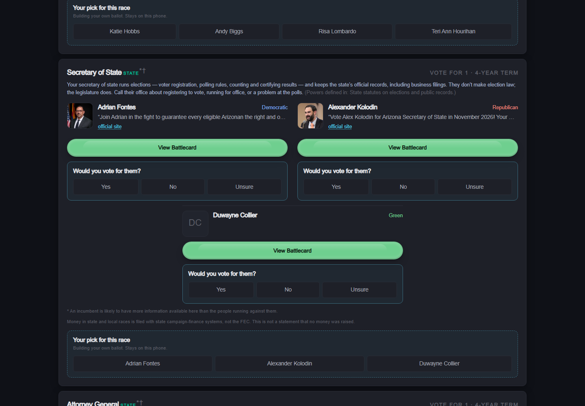

### C — three equal full-width rows, desktop 1440×1000

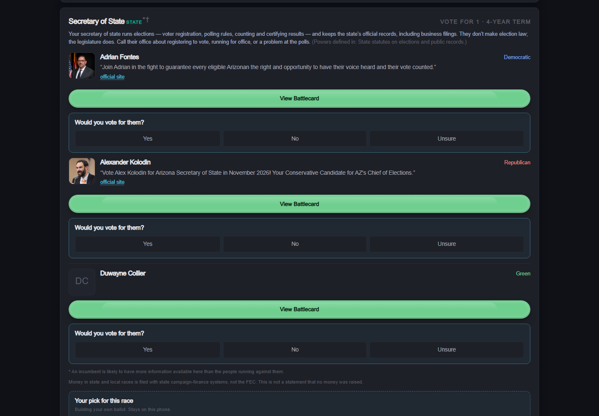

### Production responsive flow, phone 390×844

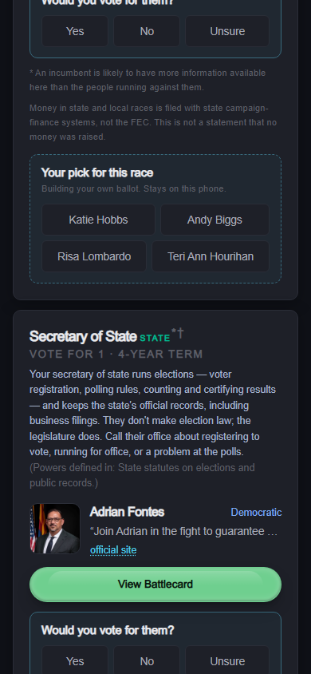

### Production responsive flow, tablet 834×1112

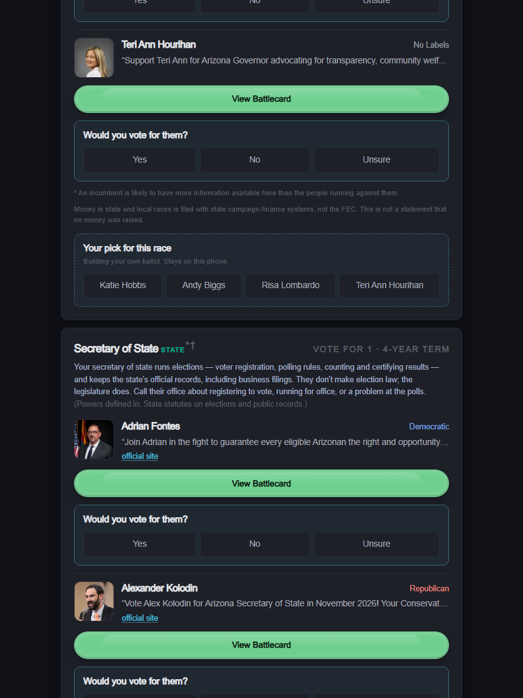

## Desktop Vote placement and raised-state review

These frames pair like-labelled review candidates so each desktop Vote
placement and each raised-state treatment can be compared in one view. Both
parameters are development-only. Missing, invalid, responsive, and production
requests retain the current production placement and state relief.

- A: standalone top-right Vote entry; soft state lift.
- B: Vote as the fourth segment of the movable command cluster; material lift.
- C: Vote as a full-width row attached beneath the cluster; deep lift.

### A — dark and light, desktop 1440×1000, state-scale zoom 5

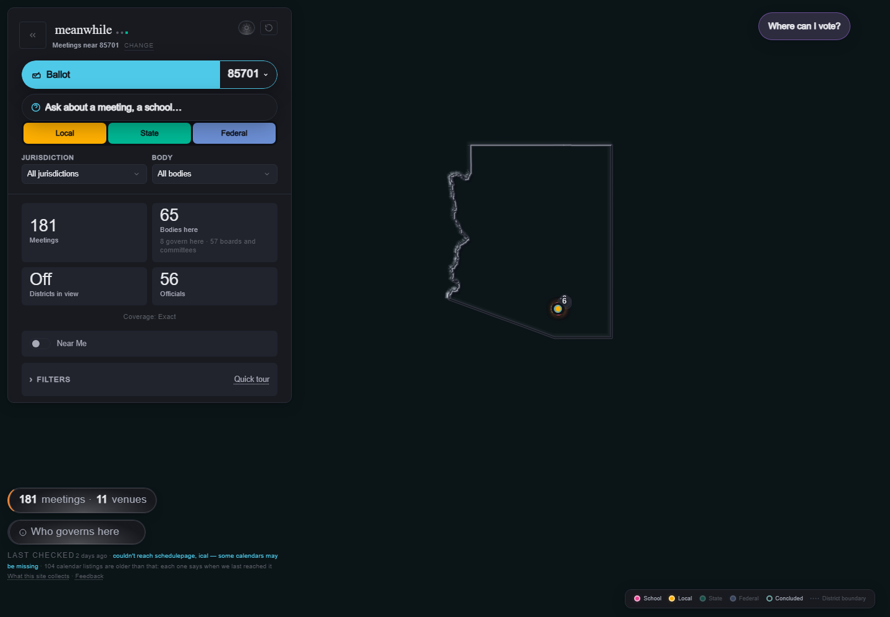

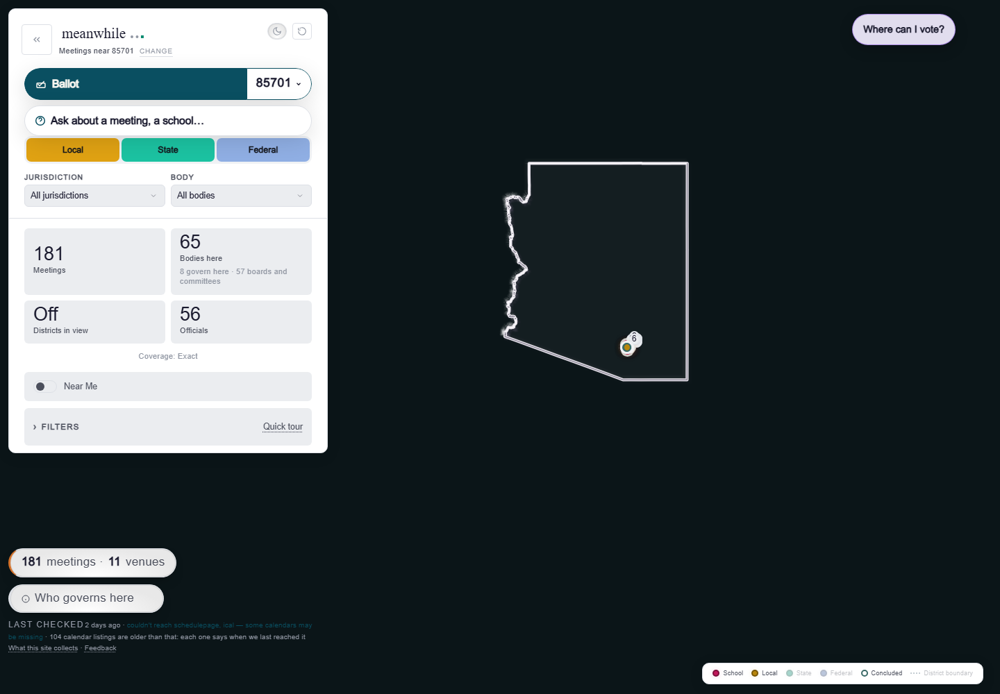

### B — dark and light, desktop 1440×1000, state-scale zoom 5

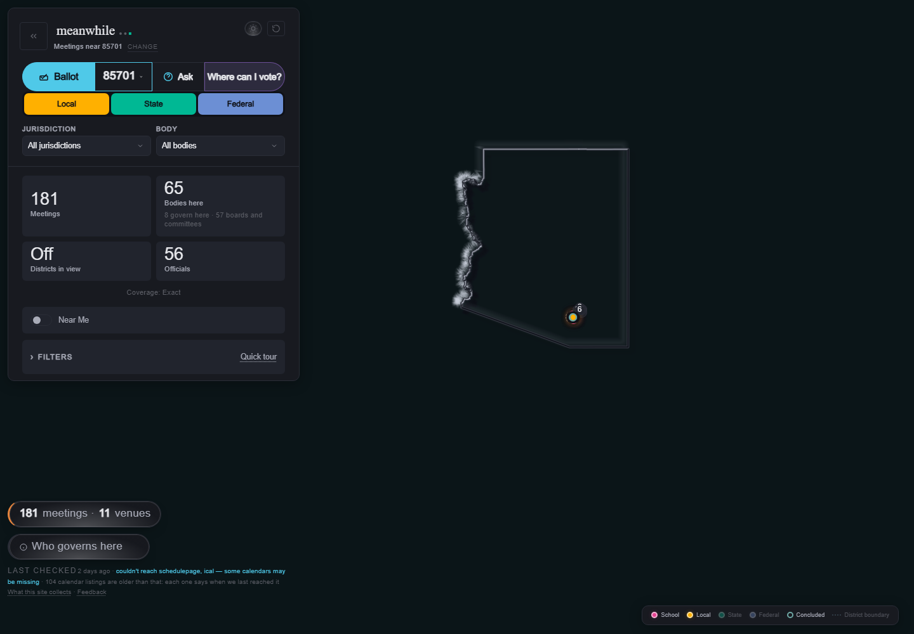

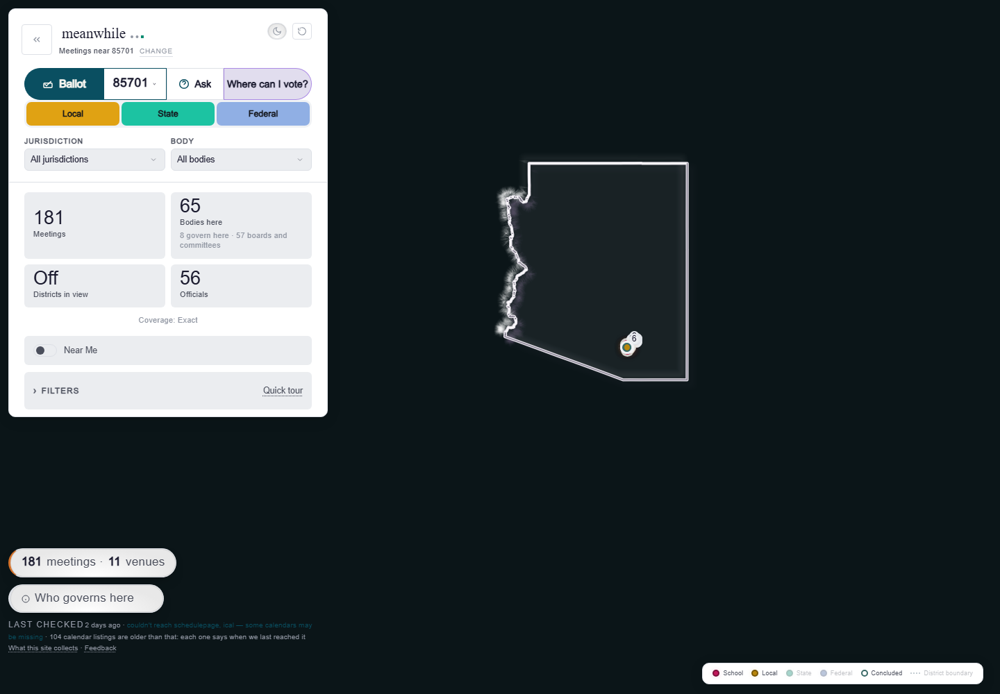

### C — dark and light, desktop 1440×1000, state-scale zoom 5

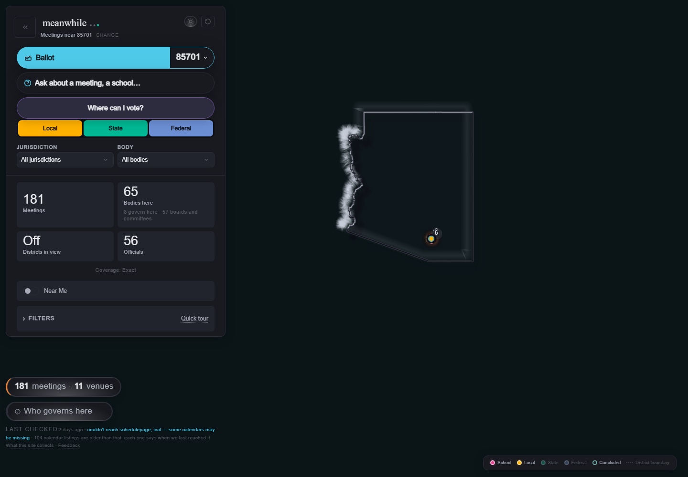

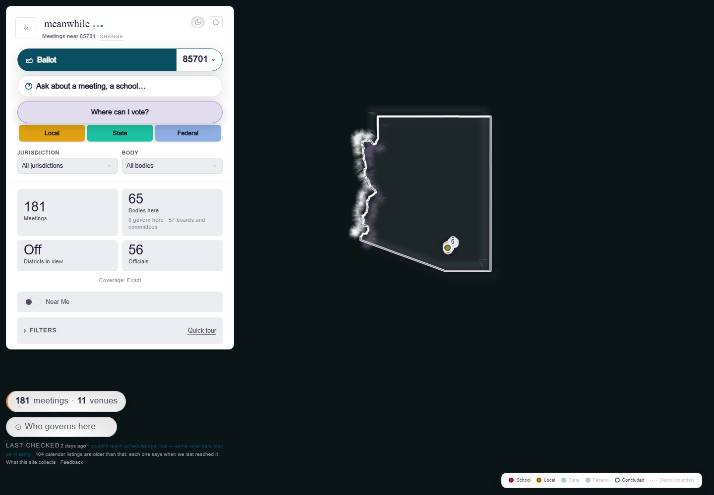

### Open-panel containment for A/B/C

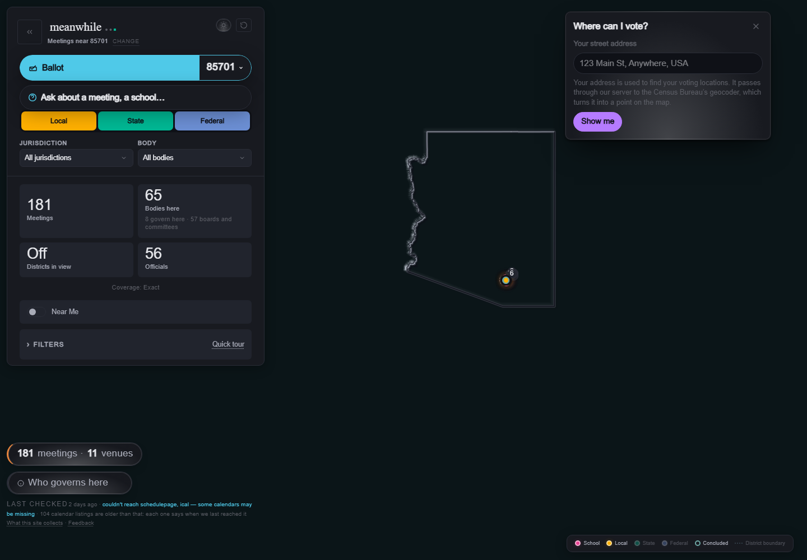

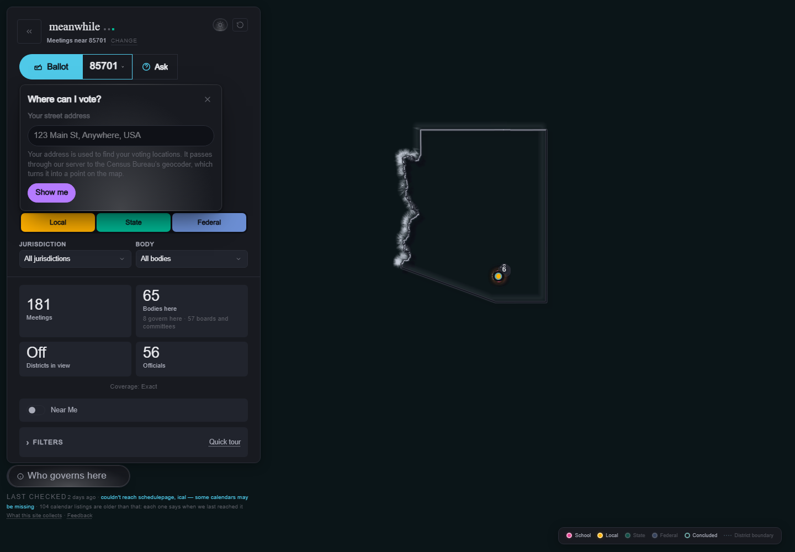

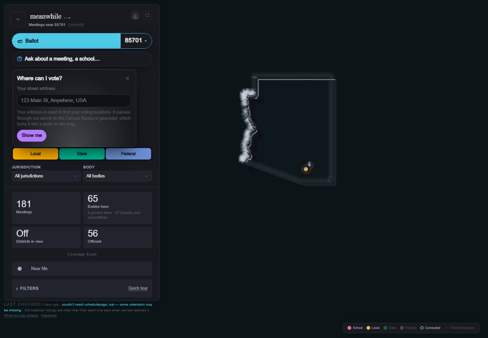

## Production responsive map

No review parameter was supplied. The phone retains `ZIP | Ballot | Ask |
Vote`; the tablet retains `Ballot | ZIP | Ask | Vote | People | Meetings`.

### Phone 390×844

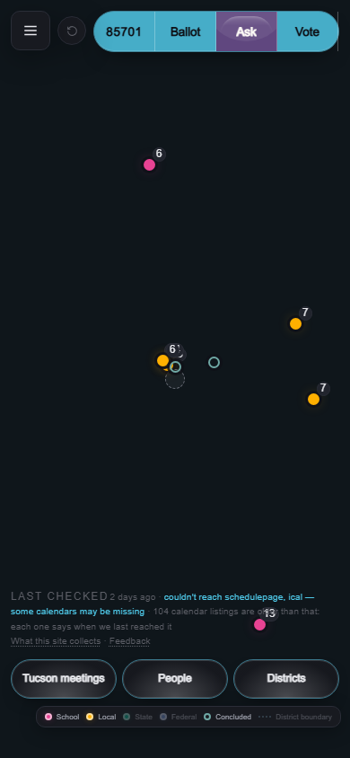

### Tablet 834×1112

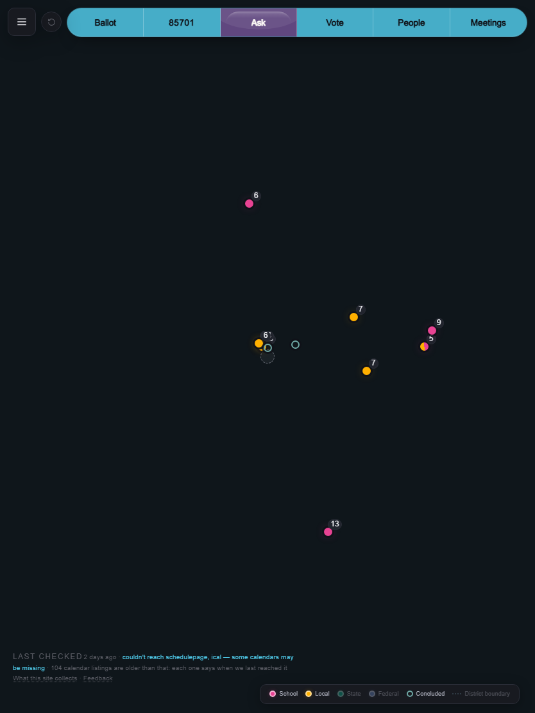
