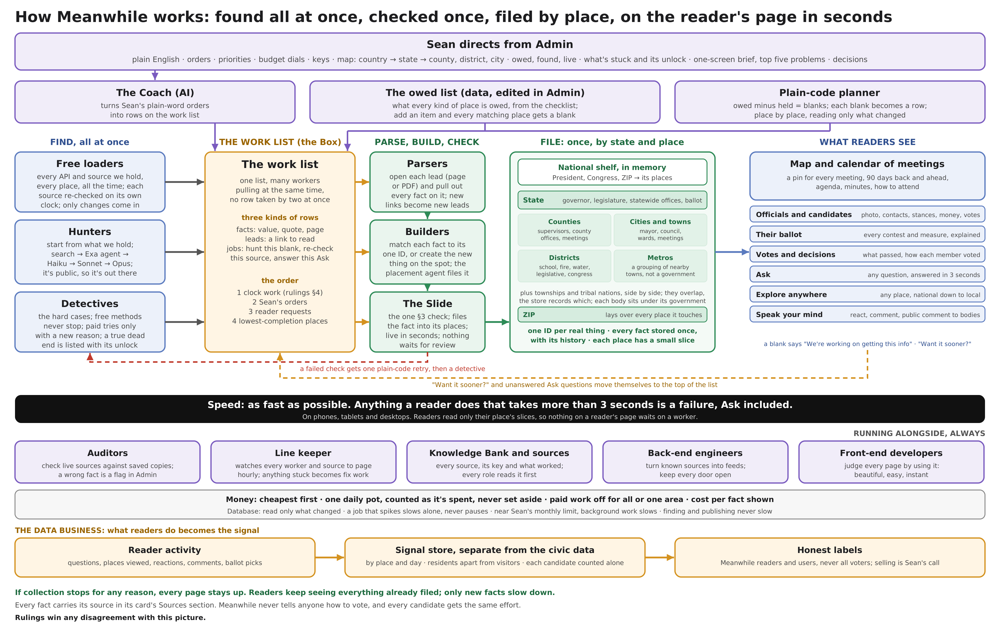

# How Meanwhile Works

*Version 5, October 28, 2026. docs/rulings.md wins any disagreement with this document. Only Sean changes it. It describes how the system works and changes only when Sean changes that, never to record progress.*

## What done means

Sean sends the system at any place, including one we hold nothing for, and walks away. Every role works at once. Everything that can be found is checked, filed and shown to readers in the right card on the live site. Everything that couldn't be found is listed in Admin with what was tried and what would unlock it.

**Nothing is done until a fact moves from its source to a reader's page on the live site.** A part that works on its own but doesn't carry facts all the way to that page is not working.

## 1. Sean directs

Admin opens on a map of the country, each state colored by how much of what readers are owed is live. Clicking a state shows its counties, cities and districts the same way, and clicking one of those shows that place. ZIPs and congressional districts appear as rows at every level. Every level has the same layout:

- Owed, found and live, as bars.

- What's stuck, grouped by what would unlock it: the government doesn't publish it, it needs paid search (with the cost), it needs a credential or contact only Sean can get, it needs a new parser for a kind of website, or our own code needs a fix.

- That level's work list. When Sean reorders it, the change counts as one of his orders.

The daily brief fits on one screen: new facts that reached readers, the top five problems, and the decisions only Sean can make, each with a recommendation. Each problem has a button to send workers at it. A fixed problem disappears; one that comes back after workers tried is marked for Sean. One line opens every other problem.

**Sean is not a coder.** Everything Admin, the brief and every session tell him is in plain, high-school English: what happened, what it means for readers, and what, if anything, he needs to do. File names, codes and IDs stay behind a "Technical details" link.

## 2. What each place is owed

The owed list is data: the owed items from the State Run Checklist, each naming which kinds of place owe it and which card it shows on. Sean adds or changes items in Admin, with a log and undo. Saving an item gives every matching place a new blank, and work on it starts at once. No code change, no release.

## 3. The work list

There is one work list, the Box. It holds three kinds of rows:

- **Facts:** a value, the exact quote and the saved page it came from.

- **Leads:** a link that should be read.

- **Jobs:** hunt this blank, re-check this source, answer this Ask question. A job that repeats, like a re-check, gets a new row each time it's due.

Hundreds of workers pull from it at the same time, and no row is ever worked by two workers at once. Nobody stands in line. A plain-code planner subtracts what we hold from what each place is owed and turns every blank into a row, place by place, reading only what changed. The Coach is an AI that turns Sean's plain-word orders into rows, tracked from Received to Done.

**The order:** clock work from rulings §4 first, then Sean's orders, then reader requests, then the least-complete places. When a reader clicks "Want us to get this sooner?" or asks Ask something we don't hold, that blank moves itself to the top of the reader tier with no approval, and the demand shows in Admin.

## 4. Find, all at once

**Free loaders** read every API and source we hold, for every place, all the time, whether or not anyone orders it. Each known source is re-checked on its own clock, and only what changed comes back in.

**Hunters** start from what we already hold and what has worked in that state and in states built the same way. They climb a ladder, cheapest first unless the Knowledge Bank shows a better tool for that kind of blank: search (Exa, Brave), then Exa's agent for a broad sweep, then our own agents on Haiku, Sonnet and Opus. Every finding goes into the Box as facts and leads, and the hunter goes straight back out.

**The hunt never ends.** This is public information the government is required to provide, so a blank stays open until it's filled, and "not found in the sources checked" never becomes "doesn't exist." After the ladder, a blank goes to a **detective**, who writes down what would unlock it. Free methods keep working on it as often as the pacing rules in rulings §2 allow. Paid tries come back whenever something gives them a new reason to work, including but not limited to the reasons in rulings §2. Paying to repeat the exact same try with nothing different never happens. A true dead end is listed in Admin with what would unlock it.

## 5. Sources and keys

**The source registry** is data: every source we can read, what places and kinds of facts it covers, and which key it uses. Free loaders and hunters look there first, so nobody has to be told where a source is.

**Keys.** Sean pastes a new key and its name into the Keys box in Admin once. It is stored in a locked spot that the runner and the website read on their own, so Sean's Admin sign-in never blocks them. The system tests every key when it's saved and every day after, shows Working or Not working, and puts a failure in the brief. No session asks Sean for a key that's already saved; a new key that's needed goes to his Decisions box.

**Adding a source.** Many governments publish through the same few platforms (open-data portals, map servers, meeting systems), and those are read by parsers that already exist, with no code change. A truly new kind of API becomes a job for a back-end engineer to write one loader, queued the moment the source is added. Hunters add every API they come across to the registry as a lead, so the list keeps growing on its own.

## 6. Parse, build, check, publish

**Parsers** open each lead, a page or a PDF, and pull out every fact on it, not only the one the hunter wanted. Each fact keeps the exact line from the page that shows its value. Those facts go back in the Box, and any new links become new leads.

**Builders** match each fact to its one ID. When a fact names something we don't hold, the builder creates it on the spot with its source and attaches the fact. A **placement agent** (Sonnet, moving to Opus only when unsure) decides where a new thing belongs, as part of a government we hold, such as a county department, or as its own government, and cites the government's own page for that choice. When two possible matches tie, it stops and goes to a detective instead of guessing.

**The Slide** is the only way a fact reaches readers. It runs the one check in rulings §3, decides which value wins exactly as rulings §3 says, files the fact into every place it belongs to, and publishes it in seconds. Nothing waits for review. A fact that fails gets one immediate plain-code retry, then goes to a detective, and its blank stays open. A kind of fact with no card yet publishes into "More about this" on its body or person, and a row goes to the front-end developers to give it a proper spot.

## 7. The store

Every real thing (a person, office, body, government, meeting or measure) has one ID. Any other name or ID it's found under becomes an alias that points to it. Every fact is stored once, with its history, so a reader can ask how someone voted years ago. Re-checks follow the freshness rule in rulings §3 and the meeting schedule in rulings §4.

Places follow how government is really built, which is not a neat nest. Each state or territory holds its kinds of places side by side: counties, townships, cities and towns, tribal nations, districts (school, fire, water, legislative, congressional and the rest) and metros, which are groupings of nearby towns and not governments. They overlap, and the store records which ones overlap which. Each body sits under the government that runs it. A ZIP lays over every place it touches.

Each place has a small slice listing what belongs on its page. Every web server keeps a small national shelf in memory: the President, Congress, and the lookup from a ZIP to its places. Workers load only their place, and nothing reads the whole country to show one place.

## 8. What readers see

- **Map and calendar of meetings,** with a pin for every meeting, its agenda, minutes and how to attend.

- **Officials and candidates,** with photo, contacts, where they stand, who funds them and how they voted.

- **Their ballot,** every contest and measure, explained.

- **Votes and decisions,** what each body decided and how every member voted.

- **Ask,** any question, answered from our facts with sources. When we don't hold the answer, Ask says so right away ("We don't hold this yet. Here's what we found, and we're getting it for you."), shows the AI's answer with its label, and the question becomes work.

- **Explore anywhere,** any ZIP, city, county or state, from national down to local.

- **Speak your mind,** react and comment, or send a public comment to a body whose meeting the reader can't attend, handled exactly as rulings §8 says.

A reader's page reads only that place's slices, so it never waits on a worker. Anything a reader does that takes more than 3 seconds is a failure, on phones, tablets and desktops alike, Ask included. A section we don't have yet says "We're working on getting this info" with the "Want us to get this sooner?" link.

## 9. How it runs

- Every role runs on its own and pulls from the work list. A stuck job ends alone and never takes another job down.

- A worker loads only its place and the districts touching it, inside the state line.

- How many workers run at once is limited only by the server and Sean's budget.

- The code holds the design in place: only the Slide can write a fact, readers can only read slices, and a release fails if it adds a table or writer outside the core. The core's tables and writers are listed in one file that check reads.

- If collection stops for any reason, every page stays up. Readers keep seeing everything already filed; only new facts slow down.

## 10. Money and the database

Cheapest first everywhere, unless the Knowledge Bank shows a better tool for the job: plain code, then search, then Haiku, Sonnet and Opus. Paid work draws from one daily pot Sean sets, counted as it's spent and never set aside ahead of time. An order can carry its own budget. Admin shows cost per fact reaching readers. Sean can turn paid work off at once, for everything or for one area, and free work never stops for money.

Jobs read only what changed, using each source's fingerprint, and never re-read a stored record to find out. A job that suddenly reads far more than its own normal slows down alone, and its fix goes to the top of the fix list. No job ever pauses for cost. Near Sean's monthly database limit, background work (re-checks, page work, planning) slows. Finding and publishing never slow.

## 11. Running alongside

**Auditors** re-check samples of live facts on a clock, cheapest first: plain code fetches the live source and compares it with the saved copy, and a model is used only when the source changed or the fact is gone. A wrong fact becomes a flag in Admin with Sean's four choices.

**The line keeper** follows facts from source to page every hour, using counts each step writes as it works. It reports how long facts take from passing the check to showing on a reader's page, and it watches every worker: any role that hasn't finished a run in two of its own intervals becomes fix work. Anything stuck becomes fix work.

**The Knowledge Bank** holds what worked and failed in each state, and every role reads it first. **Back-end engineers** turn known sources into feeds. **Front-end developers** judge every page by using it the way a resident would: beautiful, easy, instant.

## 12. The data business

What readers do becomes the signal: questions asked, places viewed, reactions, comments and ballot picks. It is stored by place and day in a signal store kept separate from the civic data, and it is never shown back to readers. Residents and visitors are counted separately, so 210 Tucson residents and 90 out-of-state readers never become one number. Each candidate is counted on their own, so the incumbent's and the challenger's numbers are never added together. Everything is labeled as Meanwhile readers and users, never as all voters.

The signal store never holds a name, email or street address. A typed address is turned into its districts and stays in the reader's own browser until they choose "Forget this address." Contact details given for a public comment are deleted once it's sent, and a feedback reply address is deleted once we've replied. What is sold, to whom and how is Sean's decision and isn't part of this design yet. Still open: how buyers get proof the counts are real.

## 13. Keeping it clean

Every lane works from this doc. A lane that hits something it doesn't cover sends the question to the lead session, which merges duplicates, answers what this doc and the rulings already answer, and brings only real design questions to Sean's Decisions box, each with a recommendation. The lane keeps working on everything else. Replaced code is deleted in the same change. docs/ holds only this doc, the design system and docs that describe how code works. Reports and proof go in release notes and Admin, never into files. Data that changes never lives in git.

## 14. Always true

Every fact carries its source in its card's Sources section. Meanwhile never tells anyone how to vote, and every candidate gets the same effort. Reader pages show public office and campaign addresses only, never anyone's home, and donors who gave \$200 or less are never named (rulings §9).
