# Portraits to eyeball

**Generated by `pnpm photo:review` — do not hand-edit.** Regenerate it and
the list is whatever is actually shipped right now.

D50 item 7b, the author's standing order: every portrait he needs to look at
in one place he can work from. A portrait is the one thing in this product a
machine cannot finally judge — every rung before this one exists to put a
picture in front of a person who can say yes or no.

Generated 2026-08-19. Manifest holds **902** portraits and
**229** named misses.

**554** of those **902** belong to a person some division
maps to, so a zip can reach them. The other **348** belong to people
with no division mapping — mostly state legislators whose seat is not wired to
a district yet — and **nothing in the product renders them**. That is why a
portrait can be in the manifest and impossible to find on screen, and it is a
MAPPING gap rather than a photo gap: the picture is fine, the seat is missing.

---

## Flagged — shipped with a stated doubt

**2** shipped carrying a doubt the author asked to see. One line
pulls any of them back out.

| Person | Portrait | Door | Source | Where it renders | What to look at |
|---|---|---|---|---|---|
| Brian Taylor |  | 2 — official portrait | [page](https://gc.nh.gov/house/images/memberpics/409302.jpg) | **not rendered anywhere** — no division maps to this person, so no zip reaches them | DISTANCE SHOT — reinstated 2026-08-19 on the author's instruction, flagged for his eye. 754×950 — a distance shot; the member is the sole subject and the identity is unambiguous, but the framing is wide. Member page: https://gc.nh.gov/house/members/member.aspx?pid=11314. One line pulls it back out. |
| Bob Harb | 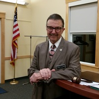 | 2 — official portrait | [page](https://gc.nh.gov/house/images/memberpics/408914.jpg) | **not rendered anywhere** — no division maps to this person, so no zip reaches them | DISTANCE SHOT — reinstated 2026-08-19 on the author's instruction, flagged for his eye. 200×200 — a distance shot at small size; sole subject, unambiguous identity, wide framing. Member page: https://gc.nh.gov/house/members/member.aspx?pid=9293. One line pulls it back out. |

---

## New since 2026-08-19

**110** collected since 2026-08-19.

| Person | Portrait | Door | Source | Where it renders | Collected |
|---|---|---|---|---|---|
| Gaby Grossman |  | unstated in the licence field | [page](https://gc.nh.gov/house/members/member.aspx?pid=9218) | **not rendered anywhere** — no division maps to this person, so no zip reaches them | 2026-08-19 |
| David Fracht |  | unstated in the licence field | [page](https://gc.nh.gov/house/members/member.aspx?pid=11041) | **not rendered anywhere** — no division maps to this person, so no zip reaches them | 2026-08-19 |
| Seth Miller |  | unstated in the licence field | [page](https://gc.nh.gov/house/members/member.aspx?pid=11291) | **not rendered anywhere** — no division maps to this person, so no zip reaches them | 2026-08-19 |
| Jack Flanagan |  | unstated in the licence field | [page](https://gc.nh.gov/house/members/member.aspx?pid=623) | **not rendered anywhere** — no division maps to this person, so no zip reaches them | 2026-08-19 |
| Mary Hakken-Phillips |  | unstated in the licence field | [page](https://gc.nh.gov/house/members/member.aspx?pid=9889) | **not rendered anywhere** — no division maps to this person, so no zip reaches them | 2026-08-19 |
| Nancy Murphy |  | unstated in the licence field | [page](https://gc.nh.gov/house/members/member.aspx?pid=9089) | **not rendered anywhere** — no division maps to this person, so no zip reaches them | 2026-08-19 |
| Allison Knab |  | unstated in the licence field | [page](https://gc.nh.gov/house/members/member.aspx?pid=10856) | **not rendered anywhere** — no division maps to this person, so no zip reaches them | 2026-08-19 |
| Julius Soti |  | unstated in the licence field | [page](https://gc.nh.gov/house/members/member.aspx?pid=9936) | **not rendered anywhere** — no division maps to this person, so no zip reaches them | 2026-08-19 |
| Chris Muns |  | unstated in the licence field | [page](https://gc.nh.gov/house/members/member.aspx?pid=755) | **not rendered anywhere** — no division maps to this person, so no zip reaches them | 2026-08-19 |
| Jim Summers |  | unstated in the licence field | [page](https://gc.nh.gov/house/members/member.aspx?pid=9294) | **not rendered anywhere** — no division maps to this person, so no zip reaches them | 2026-08-19 |
| Margaret Drye |  | unstated in the licence field | [page](https://gc.nh.gov/house/members/member.aspx?pid=9284) | **not rendered anywhere** — no division maps to this person, so no zip reaches them | 2026-08-19 |
| Michael Vose |  | unstated in the licence field | [page](https://gc.nh.gov/house/members/member.aspx?pid=909) | **not rendered anywhere** — no division maps to this person, so no zip reaches them | 2026-08-19 |
| Ross Berry |  | unstated in the licence field | [page](https://gc.nh.gov/house/members/member.aspx?pid=9919) | **not rendered anywhere** — no division maps to this person, so no zip reaches them | 2026-08-19 |
| Rick Ladd |  | unstated in the licence field | [page](https://gc.nh.gov/house/members/member.aspx?pid=582) | **not rendered anywhere** — no division maps to this person, so no zip reaches them | 2026-08-19 |
| Peter Petrigno |  | unstated in the licence field | [page](https://gc.nh.gov/house/members/member.aspx?pid=9099) | **not rendered anywhere** — no division maps to this person, so no zip reaches them | 2026-08-19 |
| Linda Harriott-Gathright |  | unstated in the licence field | [page](https://gc.nh.gov/house/members/member.aspx?pid=720) | **not rendered anywhere** — no division maps to this person, so no zip reaches them | 2026-08-19 |
| Thomas Kaczynski |  | unstated in the licence field | [page](https://gc.nh.gov/house/members/member.aspx?pid=915) | **not rendered anywhere** — no division maps to this person, so no zip reaches them | 2026-08-19 |
| Mike Harrington |  | unstated in the licence field | [page](https://gc.nh.gov/house/members/member.aspx?pid=5122) | **not rendered anywhere** — no division maps to this person, so no zip reaches them | 2026-08-19 |
| Sallie Fellows |  | unstated in the licence field | [page](https://gc.nh.gov/house/members/member.aspx?pid=9059) | **not rendered anywhere** — no division maps to this person, so no zip reaches them | 2026-08-19 |
| Terry Spilsbury |  | unstated in the licence field | [page](https://gc.nh.gov/house/members/member.aspx?pid=9950) | **not rendered anywhere** — no division maps to this person, so no zip reaches them | 2026-08-19 |
| Cindy Bennett |  | unstated in the licence field | [page](https://gc.nh.gov/house/members/member.aspx?pid=11395) | **not rendered anywhere** — no division maps to this person, so no zip reaches them | 2026-08-19 |
| Tom Cormen |  | unstated in the licence field | [page](https://gc.nh.gov/house/members/member.aspx?pid=10769) | **not rendered anywhere** — no division maps to this person, so no zip reaches them | 2026-08-19 |
| Larry Gagne |  | unstated in the licence field | [page](https://gc.nh.gov/house/members/member.aspx?pid=573) | **not rendered anywhere** — no division maps to this person, so no zip reaches them | 2026-08-19 |
| Chris McAleer | 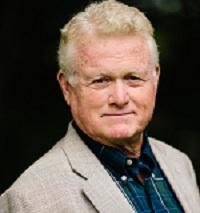 | unstated in the licence field | [page](https://gc.nh.gov/house/members/member.aspx?pid=9871) | **not rendered anywhere** — no division maps to this person, so no zip reaches them | 2026-08-19 |
| Kevin Scully |  | unstated in the licence field | [page](https://gc.nh.gov/house/members/member.aspx?pid=8351) | **not rendered anywhere** — no division maps to this person, so no zip reaches them | 2026-08-19 |
| Charlie Foote |  | unstated in the licence field | [page](https://gc.nh.gov/house/members/member.aspx?pid=10691) | **not rendered anywhere** — no division maps to this person, so no zip reaches them | 2026-08-19 |
| Dru Fox | 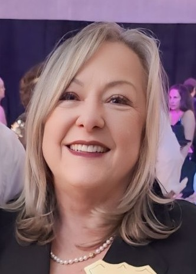 | unstated in the licence field | [page](https://gc.nh.gov/house/members/member.aspx?pid=9873) | **not rendered anywhere** — no division maps to this person, so no zip reaches them | 2026-08-19 |
| Terry Spahr |  | unstated in the licence field | [page](https://gc.nh.gov/house/members/member.aspx?pid=11184) | **not rendered anywhere** — no division maps to this person, so no zip reaches them | 2026-08-19 |
| Rich Nalevanko |  | unstated in the licence field | [page](https://gc.nh.gov/house/members/member.aspx?pid=10030) | **not rendered anywhere** — no division maps to this person, so no zip reaches them | 2026-08-19 |
| Alicia Gregg |  | unstated in the licence field | [page](https://gc.nh.gov/house/members/member.aspx?pid=10781) | **not rendered anywhere** — no division maps to this person, so no zip reaches them | 2026-08-19 |
| Alexis Simpson |  | unstated in the licence field | [page](https://gc.nh.gov/house/members/member.aspx?pid=904) | **not rendered anywhere** — no division maps to this person, so no zip reaches them | 2026-08-19 |
| Matt Coker |  | unstated in the licence field | [page](https://gc.nh.gov/house/members/member.aspx?pid=10733) | **not rendered anywhere** — no division maps to this person, so no zip reaches them | 2026-08-19 |
| Peggy Balboni |  | unstated in the licence field | [page](https://gc.nh.gov/house/members/member.aspx?pid=10885) | **not rendered anywhere** — no division maps to this person, so no zip reaches them | 2026-08-19 |
| Efstathia Booras |  | unstated in the licence field | [page](https://gc.nh.gov/house/members/member.aspx?pid=679) | **not rendered anywhere** — no division maps to this person, so no zip reaches them | 2026-08-19 |
| Julie Miles |  | unstated in the licence field | [page](https://gc.nh.gov/house/members/member.aspx?pid=11345) | **not rendered anywhere** — no division maps to this person, so no zip reaches them | 2026-08-19 |
| Douglas Trottier |  | unstated in the licence field | [page](https://gc.nh.gov/house/members/member.aspx?pid=9867) | **not rendered anywhere** — no division maps to this person, so no zip reaches them | 2026-08-19 |
| Jessica LaMontagne |  | unstated in the licence field | [page](https://gc.nh.gov/house/members/member.aspx?pid=10900) | **not rendered anywhere** — no division maps to this person, so no zip reaches them | 2026-08-19 |
| Matt Drew |  | unstated in the licence field | [page](https://gc.nh.gov/house/members/member.aspx?pid=11355) | **not rendered anywhere** — no division maps to this person, so no zip reaches them | 2026-08-19 |
| Molly Howard |  | unstated in the licence field | [page](https://gc.nh.gov/house/members/member.aspx?pid=10810) | **not rendered anywhere** — no division maps to this person, so no zip reaches them | 2026-08-19 |
| Lucius Parshall |  | unstated in the licence field | [page](https://gc.nh.gov/house/members/member.aspx?pid=9874) | **not rendered anywhere** — no division maps to this person, so no zip reaches them | 2026-08-19 |
| Maureen Mooney |  | unstated in the licence field | [page](https://gc.nh.gov/house/members/member.aspx?pid=5772) | **not rendered anywhere** — no division maps to this person, so no zip reaches them | 2026-08-19 |
| Wayne Burton |  | unstated in the licence field | [page](https://gc.nh.gov/house/members/member.aspx?pid=974) | **not rendered anywhere** — no division maps to this person, so no zip reaches them | 2026-08-19 |
| Will Darby |  | unstated in the licence field | [page](https://gc.nh.gov/house/members/member.aspx?pid=10785) | **not rendered anywhere** — no division maps to this person, so no zip reaches them | 2026-08-19 |
| Kat McGhee |  | unstated in the licence field | [page](https://gc.nh.gov/house/members/member.aspx?pid=6966) | **not rendered anywhere** — no division maps to this person, so no zip reaches them | 2026-08-19 |
| Arnie Davis |  | unstated in the licence field | [page](https://gc.nh.gov/house/members/member.aspx?pid=9882) | **not rendered anywhere** — no division maps to this person, so no zip reaches them | 2026-08-19 |
| Jennifer Rhodes |  | unstated in the licence field | [page](https://gc.nh.gov/house/members/member.aspx?pid=9878) | **not rendered anywhere** — no division maps to this person, so no zip reaches them | 2026-08-19 |
| Donald McFarlane |  | unstated in the licence field | [page](https://gc.nh.gov/house/members/member.aspx?pid=10913) | **not rendered anywhere** — no division maps to this person, so no zip reaches them | 2026-08-19 |
| Lilli Walsh |  | unstated in the licence field | [page](https://gc.nh.gov/house/members/member.aspx?pid=10692) | **not rendered anywhere** — no division maps to this person, so no zip reaches them | 2026-08-19 |
| Joe Sweeney |  | unstated in the licence field | [page](https://gc.nh.gov/house/members/member.aspx?pid=779) | **not rendered anywhere** — no division maps to this person, so no zip reaches them | 2026-08-19 |
| Denise DeDe-Poulin | 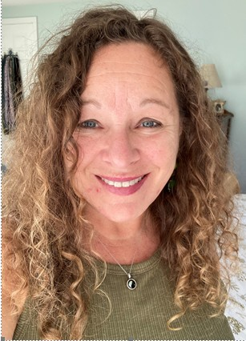 | unstated in the licence field | [page](https://gc.nh.gov/house/members/member.aspx?pid=11425) | **not rendered anywhere** — no division maps to this person, so no zip reaches them | 2026-08-19 |
| Erik Johnson |  | unstated in the licence field | [page](https://gc.nh.gov/house/members/member.aspx?pid=11134) | **not rendered anywhere** — no division maps to this person, so no zip reaches them | 2026-08-19 |
| Janet Lucas |  | unstated in the licence field | [page](https://gc.nh.gov/house/members/member.aspx?pid=11181) | **not rendered anywhere** — no division maps to this person, so no zip reaches them | 2026-08-19 |
| Vanessa Sheehan | 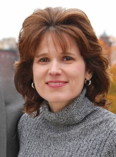 | unstated in the licence field | [page](https://gc.nh.gov/house/members/member.aspx?pid=9907) | **not rendered anywhere** — no division maps to this person, so no zip reaches them | 2026-08-19 |
| Dick Thackston |  | unstated in the licence field | [page](https://gc.nh.gov/house/members/member.aspx?pid=6938) | **not rendered anywhere** — no division maps to this person, so no zip reaches them | 2026-08-19 |
| Linda Franz | 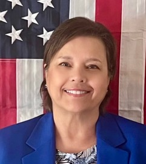 | unstated in the licence field | [page](https://gc.nh.gov/house/members/member.aspx?pid=11328) | **not rendered anywhere** — no division maps to this person, so no zip reaches them | 2026-08-19 |
| Sue DeLemus |  | unstated in the licence field | [page](https://gc.nh.gov/house/members/member.aspx?pid=947) | **not rendered anywhere** — no division maps to this person, so no zip reaches them | 2026-08-19 |
| Susan Porcelli |  | unstated in the licence field | [page](https://gc.nh.gov/house/members/member.aspx?pid=10700) | **not rendered anywhere** — no division maps to this person, so no zip reaches them | 2026-08-19 |
| Rita Mattson |  | unstated in the licence field | [page](https://gc.nh.gov/house/members/member.aspx?pid=10034) | **not rendered anywhere** — no division maps to this person, so no zip reaches them | 2026-08-19 |
| Bill Bolton |  | unstated in the licence field | [page](https://gc.nh.gov/house/members/member.aspx?pid=10765) | **not rendered anywhere** — no division maps to this person, so no zip reaches them | 2026-08-19 |
| Bill Boyd |  | unstated in the licence field | [page](https://gc.nh.gov/house/members/member.aspx?pid=10347) | **not rendered anywhere** — no division maps to this person, so no zip reaches them | 2026-08-19 |
| Liz Barbour |  | unstated in the licence field | [page](https://gc.nh.gov/house/members/member.aspx?pid=10659) | **not rendered anywhere** — no division maps to this person, so no zip reaches them | 2026-08-19 |
| Denis Murphy | 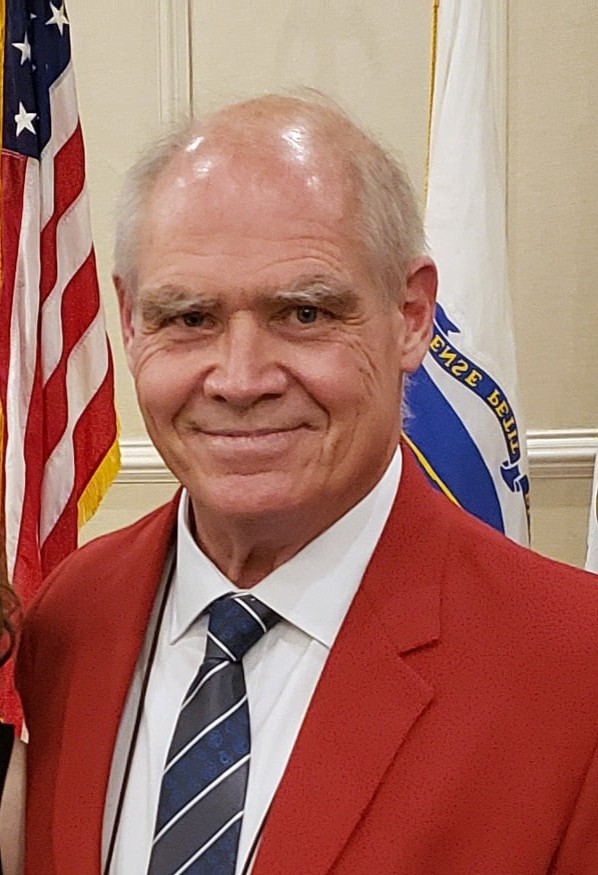 | unstated in the licence field | [page](https://gc.nh.gov/house/members/member.aspx?pid=11452) | **not rendered anywhere** — no division maps to this person, so no zip reaches them | 2026-08-19 |
| Lisa Post | 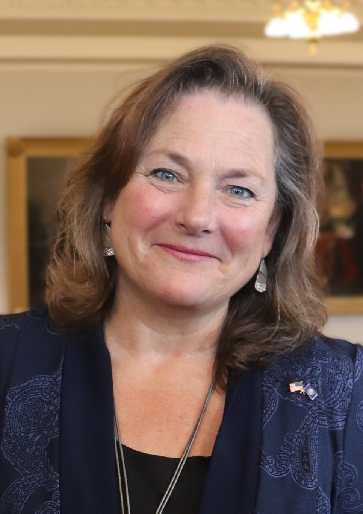 | unstated in the licence field | [page](https://gc.nh.gov/house/members/member.aspx?pid=9896) | **not rendered anywhere** — no division maps to this person, so no zip reaches them | 2026-08-19 |
| Carry Spier |  | unstated in the licence field | [page](https://gc.nh.gov/house/members/member.aspx?pid=10780) | **not rendered anywhere** — no division maps to this person, so no zip reaches them | 2026-08-19 |
| Diane Pauer |  | unstated in the licence field | [page](https://gc.nh.gov/house/members/member.aspx?pid=9910) | **not rendered anywhere** — no division maps to this person, so no zip reaches them | 2026-08-19 |
| Chris Herbert |  | unstated in the licence field | [page](https://gc.nh.gov/house/members/member.aspx?pid=856) | **not rendered anywhere** — no division maps to this person, so no zip reaches them | 2026-08-19 |
| Christal Lloyd |  | unstated in the licence field | [page](https://gc.nh.gov/house/members/member.aspx?pid=10783) | **not rendered anywhere** — no division maps to this person, so no zip reaches them | 2026-08-19 |
| Nicole Leapley |  | unstated in the licence field | [page](https://gc.nh.gov/house/members/member.aspx?pid=10800) | **not rendered anywhere** — no division maps to this person, so no zip reaches them | 2026-08-19 |
| Wayne MacDonald |  | unstated in the licence field | [page](https://gc.nh.gov/house/members/member.aspx?pid=9951) | **not rendered anywhere** — no division maps to this person, so no zip reaches them | 2026-08-19 |
| Dan Veilleux |  | unstated in the licence field | [page](https://gc.nh.gov/house/members/member.aspx?pid=9905) | **not rendered anywhere** — no division maps to this person, so no zip reaches them | 2026-08-19 |
| Valerie McDonnell | 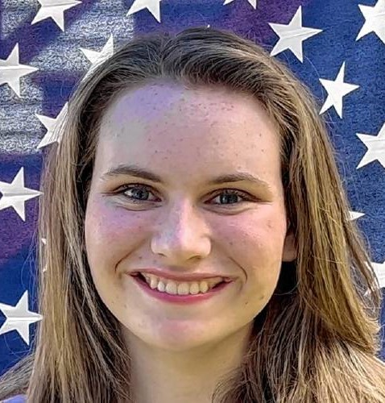 | unstated in the licence field | [page](https://gc.nh.gov/house/members/member.aspx?pid=10706) | **not rendered anywhere** — no division maps to this person, so no zip reaches them | 2026-08-19 |
| Pam Brown |  | unstated in the licence field | [page](https://gc.nh.gov/house/members/member.aspx?pid=11407) | **not rendered anywhere** — no division maps to this person, so no zip reaches them | 2026-08-19 |
| Gerry Griffin |  | unstated in the licence field | [page](https://gc.nh.gov/house/members/member.aspx?pid=8314) | **not rendered anywhere** — no division maps to this person, so no zip reaches them | 2026-08-19 |
| David Walker |  | unstated in the licence field | [page](https://gc.nh.gov/house/members/member.aspx?pid=10716) | **not rendered anywhere** — no division maps to this person, so no zip reaches them | 2026-08-19 |
| Tanya Donnelly |  | unstated in the licence field | [page](https://gc.nh.gov/house/members/member.aspx?pid=10704) | **not rendered anywhere** — no division maps to this person, so no zip reaches them | 2026-08-19 |
| Erica Layon |  | unstated in the licence field | [page](https://gc.nh.gov/house/members/member.aspx?pid=9935) | **not rendered anywhere** — no division maps to this person, so no zip reaches them | 2026-08-19 |
| Bill Ohm |  | unstated in the licence field | [page](https://gc.nh.gov/house/members/member.aspx?pid=968) | **not rendered anywhere** — no division maps to this person, so no zip reaches them | 2026-08-19 |
| Lou Juris |  | unstated in the licence field | [page](https://gc.nh.gov/house/members/member.aspx?pid=10782) | **not rendered anywhere** — no division maps to this person, so no zip reaches them | 2026-08-19 |
| Brian Labrie | 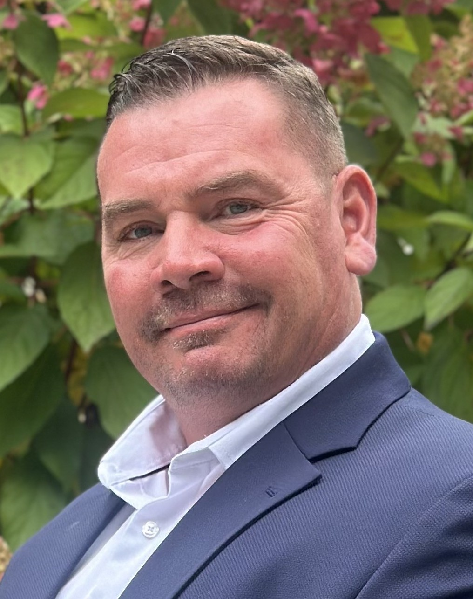 | unstated in the licence field | [page](https://gc.nh.gov/house/members/member.aspx?pid=11336) | **not rendered anywhere** — no division maps to this person, so no zip reaches them | 2026-08-19 |
| Hope Damon |  | unstated in the licence field | [page](https://gc.nh.gov/house/members/member.aspx?pid=10910) | **not rendered anywhere** — no division maps to this person, so no zip reaches them | 2026-08-19 |
| Shane Sirois |  | unstated in the licence field | [page](https://gc.nh.gov/house/members/member.aspx?pid=10653) | **not rendered anywhere** — no division maps to this person, so no zip reaches them | 2026-08-19 |
| Lucy Weber |  | unstated in the licence field | [page](https://gc.nh.gov/house/members/member.aspx?pid=531) | **not rendered anywhere** — no division maps to this person, so no zip reaches them | 2026-08-19 |
| Steve Bogert |  | unstated in the licence field | [page](https://gc.nh.gov/house/members/member.aspx?pid=10573) | **not rendered anywhere** — no division maps to this person, so no zip reaches them | 2026-08-19 |
| Lisa Freeman | 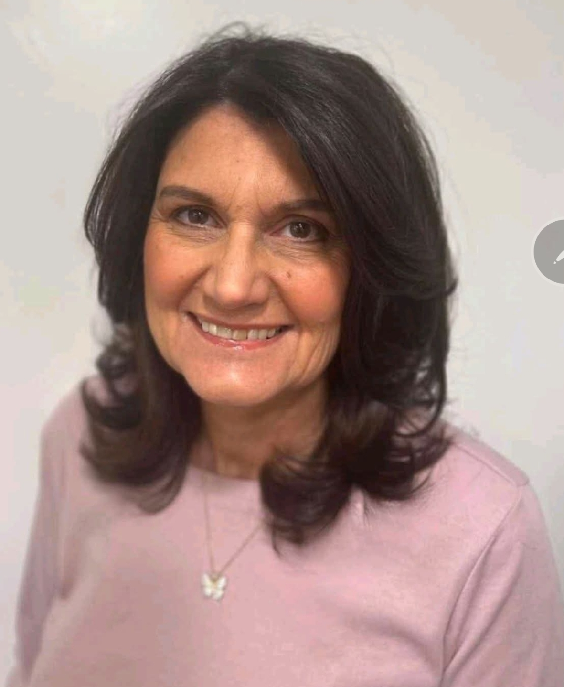 | unstated in the licence field | [page](https://gc.nh.gov/house/members/member.aspx?pid=8324) | **not rendered anywhere** — no division maps to this person, so no zip reaches them | 2026-08-19 |
| Laura Telerski |  | unstated in the licence field | [page](https://gc.nh.gov/house/members/member.aspx?pid=9117) | **not rendered anywhere** — no division maps to this person, so no zip reaches them | 2026-08-19 |
| Ralph Boehm |  | unstated in the licence field | [page](https://gc.nh.gov/house/members/member.aspx?pid=502) | **not rendered anywhere** — no division maps to this person, so no zip reaches them | 2026-08-19 |
| Heather Baldwin | 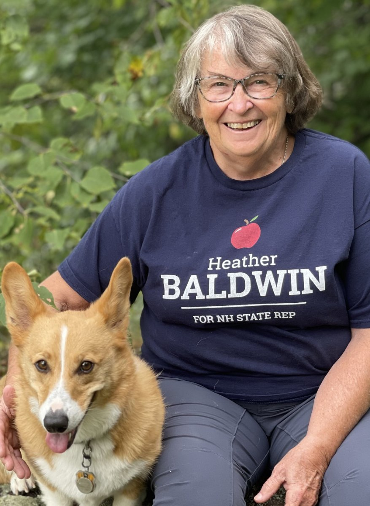 | unstated in the licence field | [page](https://gc.nh.gov/house/members/member.aspx?pid=10762) | **not rendered anywhere** — no division maps to this person, so no zip reaches them | 2026-08-19 |
| Luz Bay |  | unstated in the licence field | [page](https://gc.nh.gov/house/members/member.aspx?pid=10904) | **not rendered anywhere** — no division maps to this person, so no zip reaches them | 2026-08-19 |
| Erin Kerwin |  | unstated in the licence field | [page](https://gc.nh.gov/house/members/member.aspx?pid=11218) | **not rendered anywhere** — no division maps to this person, so no zip reaches them | 2026-08-19 |
| Katelyn Kuttab |  | unstated in the licence field | [page](https://gc.nh.gov/house/members/member.aspx?pid=10695) | **not rendered anywhere** — no division maps to this person, so no zip reaches them | 2026-08-19 |
| Lorie Ball |  | unstated in the licence field | [page](https://gc.nh.gov/house/members/member.aspx?pid=10702) | **not rendered anywhere** — no division maps to this person, so no zip reaches them | 2026-08-19 |
| Kelley Potenza |  | unstated in the licence field | [page](https://gc.nh.gov/house/members/member.aspx?pid=10726) | **not rendered anywhere** — no division maps to this person, so no zip reaches them | 2026-08-19 |
| Sly Karasinski | 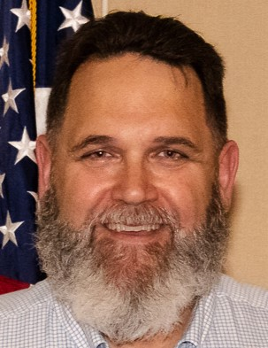 | unstated in the licence field | [page](https://gc.nh.gov/house/members/member.aspx?pid=10037) | **not rendered anywhere** — no division maps to this person, so no zip reaches them | 2026-08-19 |
| Jim Gruber |  | unstated in the licence field | [page](https://gc.nh.gov/house/members/member.aspx?pid=11171) | **not rendered anywhere** — no division maps to this person, so no zip reaches them | 2026-08-19 |
| Ray Peeples | 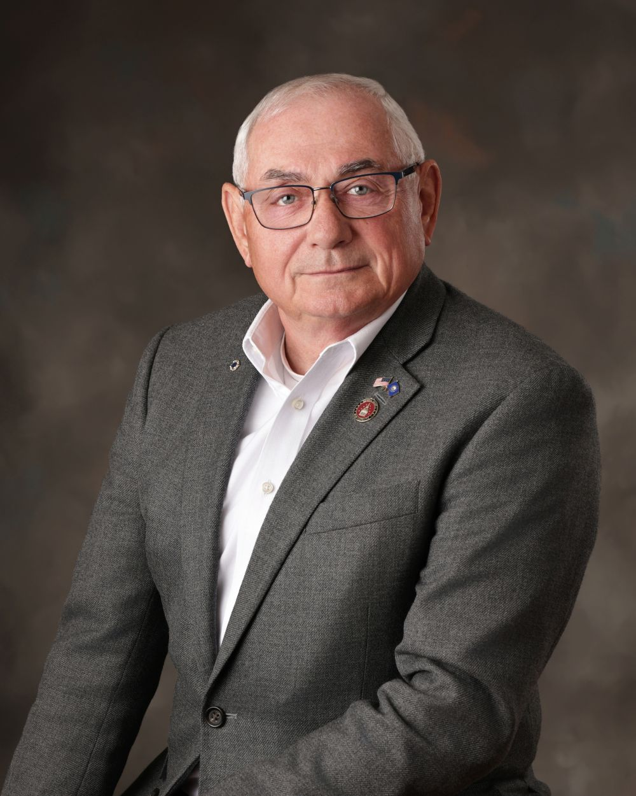 | unstated in the licence field | [page](https://gc.nh.gov/house/members/member.aspx?pid=11350) | **not rendered anywhere** — no division maps to this person, so no zip reaches them | 2026-08-19 |
| Richard Tripp |  | unstated in the licence field | [page](https://gc.nh.gov/house/members/member.aspx?pid=8408) | **not rendered anywhere** — no division maps to this person, so no zip reaches them | 2026-08-19 |
| Keith Ammon |  | unstated in the licence field | [page](https://gc.nh.gov/house/members/member.aspx?pid=836) | **not rendered anywhere** — no division maps to this person, so no zip reaches them | 2026-08-19 |
| Susan Elberger |  | unstated in the licence field | [page](https://gc.nh.gov/house/members/member.aspx?pid=10778) | **not rendered anywhere** — no division maps to this person, so no zip reaches them | 2026-08-19 |
| Erica de Vries | 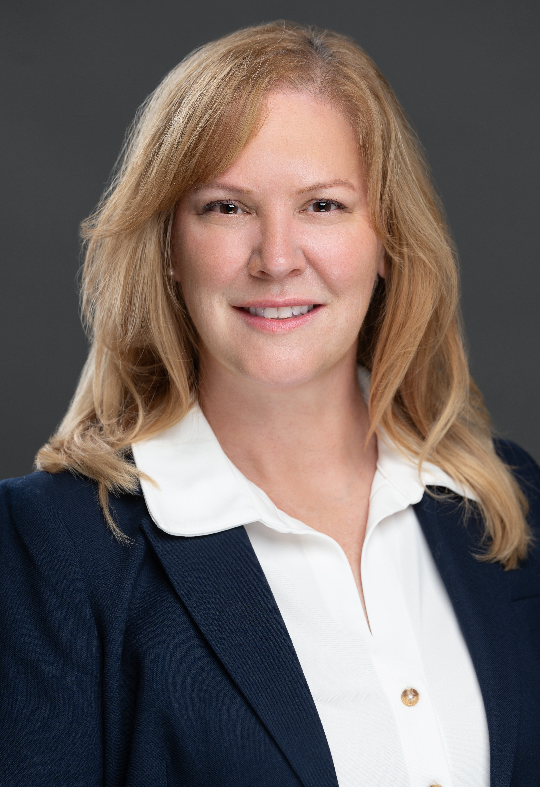 | unstated in the licence field | [page](https://gc.nh.gov/house/members/member.aspx?pid=10887) | **not rendered anywhere** — no division maps to this person, so no zip reaches them | 2026-08-19 |
| Manoj Chourasia |  | unstated in the licence field | [page](https://gc.nh.gov/house/members/member.aspx?pid=11194) | **not rendered anywhere** — no division maps to this person, so no zip reaches them | 2026-08-19 |
| Dan LeClerc |  | unstated in the licence field | [page](https://gc.nh.gov/house/members/member.aspx?pid=10814) | **not rendered anywhere** — no division maps to this person, so no zip reaches them | 2026-08-19 |
| Cathy Kenny | 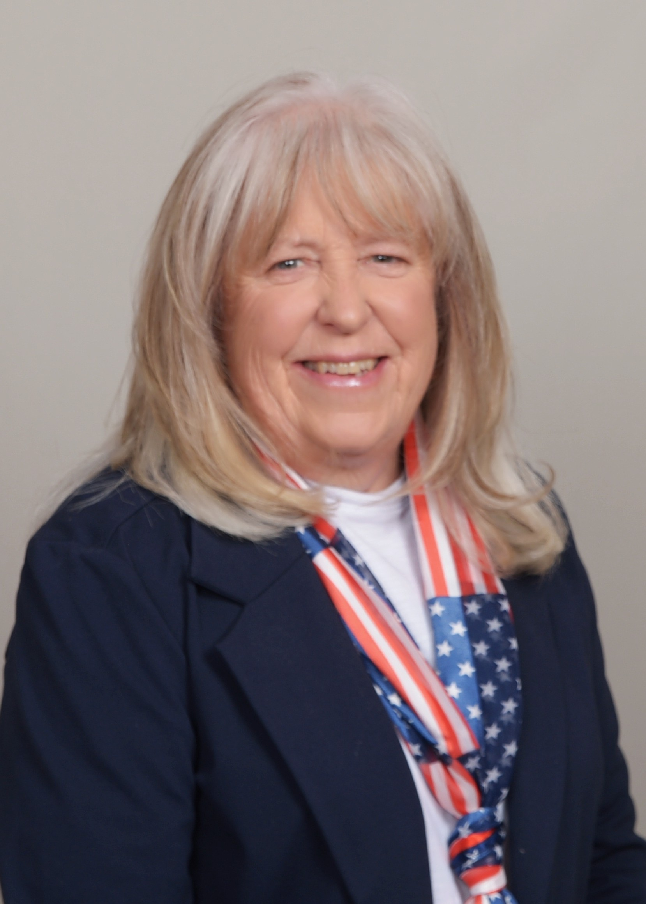 | unstated in the licence field | [page](https://gc.nh.gov/house/members/member.aspx?pid=10640) | **not rendered anywhere** — no division maps to this person, so no zip reaches them | 2026-08-19 |
| Sanjeev Manohar |  | unstated in the licence field | [page](https://gc.nh.gov/house/members/member.aspx?pid=11192) | **not rendered anywhere** — no division maps to this person, so no zip reaches them | 2026-08-19 |
| Brian Cole |  | unstated in the licence field | [page](https://gc.nh.gov/house/members/member.aspx?pid=7267) | **not rendered anywhere** — no division maps to this person, so no zip reaches them | 2026-08-19 |
| Lisa Mazur |  | unstated in the licence field | [page](https://gc.nh.gov/house/members/member.aspx?pid=10667) | **not rendered anywhere** — no division maps to this person, so no zip reaches them | 2026-08-19 |
| Robert Wherry |  | unstated in the licence field | [page](https://gc.nh.gov/house/members/member.aspx?pid=10641) | **not rendered anywhere** — no division maps to this person, so no zip reaches them | 2026-08-19 |
| Kristine Perez |  | unstated in the licence field | [page](https://gc.nh.gov/house/members/member.aspx?pid=10694) | **not rendered anywhere** — no division maps to this person, so no zip reaches them | 2026-08-19 |
| Paul Berch |  | unstated in the licence field | [page](https://gc.nh.gov/house/members/member.aspx?pid=676) | **not rendered anywhere** — no division maps to this person, so no zip reaches them | 2026-08-19 |
| Eric Turer |  | unstated in the licence field | [page](https://gc.nh.gov/house/members/member.aspx?pid=9999) | **not rendered anywhere** — no division maps to this person, so no zip reaches them | 2026-08-19 |
| John Larochelle |  | unstated in the licence field | [page](https://gc.nh.gov/house/members/member.aspx?pid=11288) | **not rendered anywhere** — no division maps to this person, so no zip reaches them | 2026-08-19 |

---

## What the standard is, so a review is against something

A clean solo portrait or honest initials. Never a wrong face, a banner, a
logo, a wordmark, a group shot, an event candid where the person is not the
unambiguous sole subject, a screengrab, or a generated likeness. **Any doubt
about identity fails at every door.**

Composition is a different question from identity, and it is the one the
flagged rows above are asking about.

